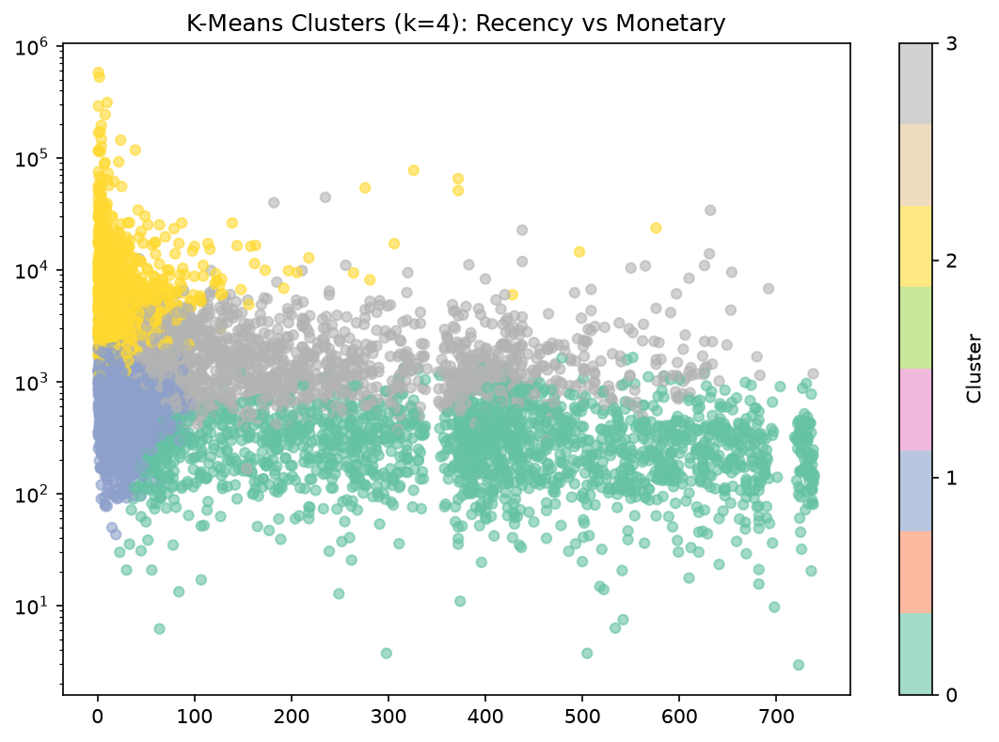

# Customer Segmentation & RFM Analysis

**Takeaway:** 20% of customers drive 74% of revenue. A rule-based RFM model and a K-Means model, built independently, found nearly the same customer groups. That agreement is the evidence the segments are real.


## The problem

A UK online gift retailer sells to thousands of customers, but treats them all the same. Who are the best customers? Who is about to leave? Where should marketing money go?

This project answers those questions by grouping customers on **how recently, how often, and how much** they buy.

## Dataset

[Online Retail II (UCI)](https://archive.ics.uci.edu/dataset/502/online+retail+ii): real transactions from a UK online retailer, Dec 2009 to Dec 2011.

- 1,067,371 rows, 8 columns (Invoice, StockCode, Description, Quantity, InvoiceDate, Price, Customer ID, Country)
- One row = one product line on one order

## Method

**1. Cleaning** (1,067,371 → 779,425 rows)
- Dropped rows with no Customer ID (~243K), since RFM needs a customer
- Removed cancellations (Invoice starting with "C")
- Removed zero or negative quantity and price
- Dropped duplicates, converted dates, created `Revenue = Quantity × Price`

**2. RFM features** (5,878 customers)
- **Recency:** days since last purchase, measured from the day after the last date in the data (not today's date)
- **Frequency:** number of unique invoices
- **Monetary:** total spend (£)

**3. Rule-based segmentation**
- Scored each metric 1 to 5 using quintiles (`pd.qcut`)
- Mapped R and F scores to 6 labeled segments

**4. K-Means clustering**
- Log-transformed (`log1p`) and standardized the features, because Monetary is heavily skewed
- Chose k=4 using the elbow method and silhouette score
- Silhouette score: **0.365**

## Results: rule-based segments

| Segment | Customers | % of customers | % of revenue | Avg spend |
|---|---|---|---|---|
| Champions | 1,482 | 25.2% | **69.2%** | £8,114 |
| Loyal | 1,221 | 20.8% | 14.4% | £2,056 |
| At Risk | 824 | 14.0% | 9.1% | £1,929 |
| Lost | 1,523 | 25.9% | 3.8% | £430 |
| New / Promising | 443 | 7.5% | 2.3% | £885 |
| Needs Attention | 385 | 6.5% | 1.2% | £531 |

Champions and Loyal together are 46% of customers but 84% of revenue.

## Results: K-Means clusters

| Cluster | Customers | Avg recency | Avg orders | Avg spend | % of revenue |
|---|---|---|---|---|---|
| Champions | 1,196 (20.3%) | 28 days | 19.3 | £10,731 | **73.9%** |
| Fading Regulars | 1,459 (24.8%) | 230 days | 5.1 | £1,949 | 16.4% |
| Recent Low-Spenders | 1,250 (21.3%) | 28 days | 3.1 | £858 | 6.2% |
| Lapsed Low-Value | 1,973 (33.6%) | 395 days | 1.4 | £317 | 3.6% |



## Do the two methods agree?

Mostly, yes. Comparing the rule-based segments with the K-Means clusters:

- 94% of **Lost** customers landed in the Lapsed Low-Value cluster
- 91% of **New / Promising** customers landed in the Recent Low-Spenders cluster
- 76% of **At Risk** customers landed in Fading Regulars
- 72% of **Champions** landed in the K-Means Champions cluster

The gaps come from the inputs: the rules use only R and F, while K-Means also uses spend. That's why some rule-based Champions with smaller spend end up in a different cluster.

## Recommendations

| Group | Action |
|---|---|
| Champions | VIP perks, early access, loyalty rewards. Protect these accounts. |
| Fading Regulars / At Risk | Personalised win-back offers. 824 At-Risk customers represent £1.6M in past revenue. |
| Recent Low-Spenders | Bundles and volume discounts to grow basket size |
| Lapsed Low-Value | One cheap automated reactivation email, then stop spending |

## Tools

Python, pandas, NumPy, matplotlib, seaborn, scikit-learn, Jupyter

## Repo structure

```
├── rfm_analysis.ipynb        # full notebook
├── customers_vs_revenue.png
├── kmeans_clusters.png
└── README.md
```

## Limitations

- Only 2 years of data, so seasonality is not modeled
- Customers without an ID (~23% of rows) were excluded
- K-Means clusters overlap at the edges (silhouette 0.365), which is typical for real behavior data

## Author

Junaid · [GitHub](https://github.com/JunaidAshraf05) · [Portfolio](https://junaidashraf05.github.io/Portfolio1)
